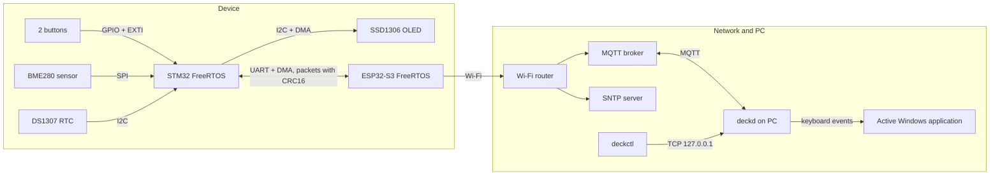
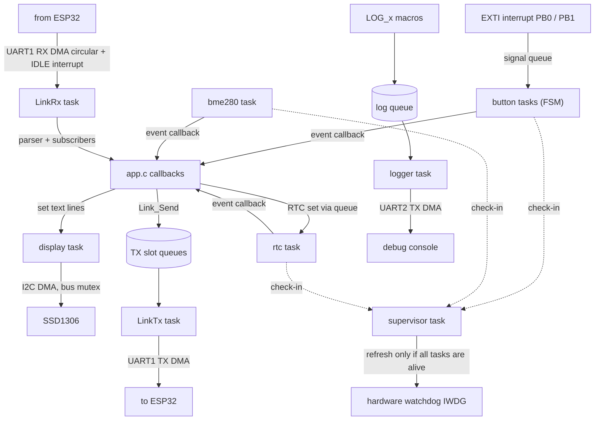
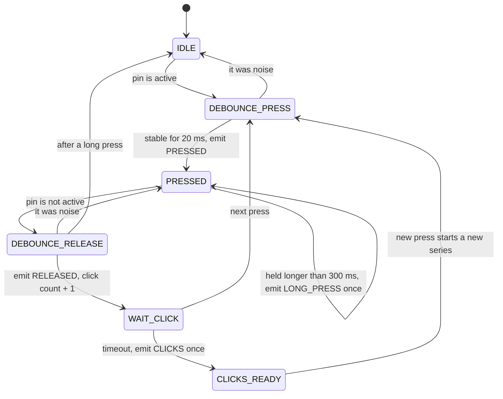
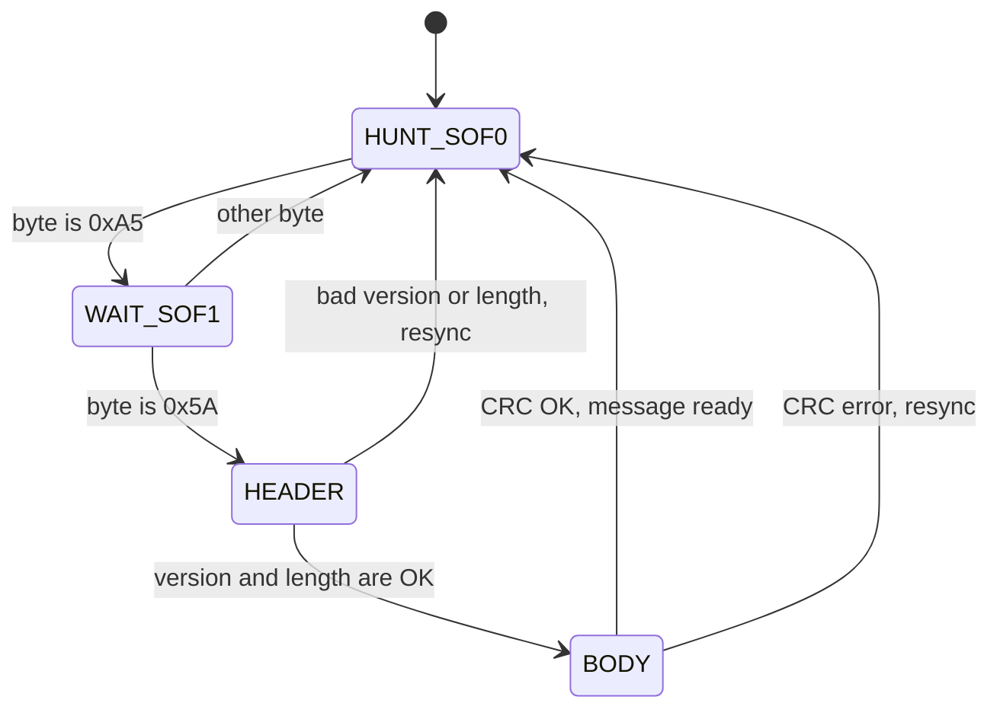

# Architecture

This document explains how the system is built: the main blocks, the tasks, the state machines
and how we avoid race conditions.

## 1. Why RTOS (and not a super loop)

Both microcontrollers run **FreeRTOS**.

- The STM32 has many independent jobs: two buttons, a sensor, a clock, a display, a UART link, a logger.
  Each job has its own timing. With tasks, each job can sleep and wake up only when it has work.
- No code uses a blocking `HAL_Delay()`. Tasks wait on queues, notifications or `vTaskDelay()`,
  so other tasks can run.
- Interrupts only wake a task (or put a small item in a queue). The real work is done in tasks.

## 2. System block diagram



## 3. STM32 firmware

### 3.1 Layers

| Layer | Folder | What it does |
|---|---|---|
| Application | `stm32/Cmd/App` | Starts all modules and connects them with callbacks. Routes HAL interrupt callbacks to modules. |
| Drivers (BSP) | `stm32/BSP` | `Button`, `bme280`, `ds1307`, `ssd1306`, `I2C_BUS` (bus lock) |
| Common services | `stm32/Common` | `FSM`, `Link`, `Logger`, `Supervisor`, `Memstat`, `result.h` |
| Shared protocol | `common/proto` | Packet format and message encode/decode. Same code on STM32 and ESP32. |
| Generated | `stm32/Core` | CubeMX code: clocks, GPIO, DMA, UART, I2C, SPI, IWDG |

Each driver is a separate module with its own `.c/.h` files, its own task and a small public API.
Drivers do not know each other. Only `app.c` connects them.

### 3.2 Data flow inside the STM32



### 3.3 Tasks

| Task | Created by | Wakes up when | Main job |
|---|---|---|---|
| `button` (one per button) | `Button_Init` | EXTI edge, or a time event (debounce, long press, click timeout) | Runs the button FSM and sends events |
| `rtc` | `DS1307_Init` | Every 250 ms, or a "set time" request in the queue | Reads time, sends an event when the time changes |
| `bme280` | `BME280_Init` | Every 1000 ms | Measures, converts with Bosch formulas, sends an event when the change is big enough |
| display task | `SSD1306_Init` | A text line changed (dirty flag) or a timeout | Draws the screen with u8g2 and sends it with I2C DMA |
| `LinkTx` | `Link_Init` | A packet is in the ready queue | Builds a packet and sends it with UART DMA |
| `LinkRx` | `Link_Init` | DMA half/full buffer, UART IDLE line, or poll timeout (50 ms) | Reads the ring buffer, runs the parser, calls subscribers |
| `status` | `App_Init` | Every 5 s | Sends uptime, heap and device flags to the ESP32 |
| logger task | `Logger_Init` | A log event is in the queue | Formats text and sends it with UART DMA |
| `Supervisor` | `Supervisor_Init` | Every 500 ms (`vTaskDelayUntil`) | Checks that tasks are alive, checks stacks, feeds the IWDG |

Priorities (in `app.c`): logger is the lowest, `Link` tasks are in the middle, `Supervisor` is the highest.
So logging never delays the communication, and the watchdog check always runs.

### 3.4 State machines

The project has its own small FSM library (`Common/FSM`). A state has optional `enter`, `update` and `exit` functions.

**Button FSM** (one instance per button). Debounce time is 20 ms. Click timeout and long-press time are 300 ms.



**Protocol parser** (reads one byte at a time):



On an error the parser does **not** throw away all bytes. It skips only the first byte and reads the rest again,
because a real packet start can be hidden inside the broken data.

### 3.5 Synchronization and no race conditions

| Shared resource | Who uses it | Protection |
|---|---|---|
| I2C bus | OLED task and RTC task | Mutex (`I2C_Bus_Lock/Unlock`) with timeout. The mutex is never held while waiting for something else. |
| Link statistics and subscriber list | `LinkRx`, `LinkTx`, other tasks | Mutex. Callbacks are called **after** unlock (no deadlock). Interrupt counters use atomic add. |
| TX messages | Any task -> `LinkTx` | Two queues of slot indexes (free / ready). A slot has only one owner at a time. |
| Last sensor / time value | Driver task and readers | `taskENTER_CRITICAL()` around a short copy |
| RTC "set time" request | Any task -> `rtc` task | Queue. Only the `rtc` task writes to the chip. |
| Button signals | EXTI interrupt -> button task | Queue (`xQueueSendFromISR`). The task reads the real pin state, so extra signals are harmless. |
| Supervisor task list | Tasks register at start | Atomic counter. `is_active` is set **last**, with release/acquire order. |
| ESP32 cached JSON | MQTT, bridge task | Mutex (`s_lock`) |
| `deckd` config | MQTT, IPC and timer threads | `RLock` |

## 4. ESP32 firmware

The ESP32 part is a **bridge**. It has no real-time logic.

- `components/link` has the same API as the STM32 `Link`, but it uses the ESP-IDF UART driver (it has its own buffers).
- `components/bridge` starts Wi-Fi (station mode), MQTT and SNTP. It converts protocol messages to MQTT topics (JSON)
  and MQTT commands to protocol messages.
- `main/main.c` subscribes to message ids and passes the data to the bridge. It also keeps the local button state.

Reliability on the ESP32: automatic Wi-Fi reconnect (with a 1 s pause), MQTT reconnect (5 s), "last will"
message `offline`, cached data is published again after reconnect, and the bridge task reports
if the STM32 is silent for more than 30 s (configurable).

## 5. PC software

```
MQTT (button events) -> deckd -> finds active exe (SetWinEventHook) -> looks up config.yaml -> sends hotkey / runs command
deckctl --TCP 127.0.0.1--> deckd   (learn mode, list, add, remove bindings)
```

- Actions are executed in a separate worker thread, so a slow action does not block MQTT.
- Window change events are debounced (Alt+Tab creates many events).
- A broken `config.yaml` is renamed to `config.yaml.bad` and the daemon starts with defaults.

## 6. Reliability design

| Problem | Reaction |
|---|---|
| A task hangs | It stops calling `Supervisor_CheckIn`. The supervisor stops refreshing the IWDG. The MCU resets (about 2 s). The reset reason is logged at start. |
| Stack overflow | `vApplicationStackOverflowHook` resets the MCU at once. The supervisor also warns when free stack is low. |
| UART noise or lost bytes | CRC16 check, parser resync, error counters (`rx_crc_errors`, `rx_overflow`, ...). |
| UART hardware error | The error callback sets a flag. `LinkRx` restarts the DMA receive. |
| UART TX does not finish | TX timeout, abort, counter `tx_timeouts`. |
| I2C stuck | DMA timeout leads to `HAL_I2C_DeInit` + `HAL_I2C_Init`. The OLED is marked offline and retried. |
| Sensor does not answer | After 3 failed measurements the BME280 is calibrated again. Status flags show which device is online. |
| Wrong RTC data | BCD digits and ranges are checked. Wrong readings are ignored. |
| Wrong "set time" request | Date is validated (also leap years). The request is rejected and logged. |

## 7. Memory

- All memory is allocated **once at start** (`pvPortMalloc`, static pools). There is no allocation in the main loops.
- TX uses a fixed pool of slots. `Link_Send()` copies the payload once into a slot.
- The parser returns a **pointer** to the payload inside its own buffer (no extra copy).
- The logger puts only a pointer to the format string and up to 6 arguments in the queue (about 40 bytes).
  The text is built later by the logger task.
