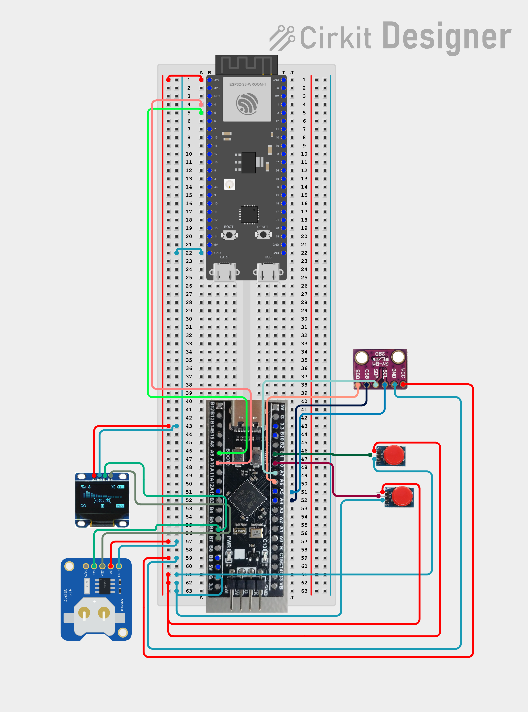

# Hardware

## 1. Parts

| Part | Notes |
|---|---|
| STM32F4 "Black Pill" board | 25 MHz crystal. The firmware runs at 84 MHz (PLL: M=25, N=168, P=2). |
| ESP32-S3-WROOM-1 dev board | Wi-Fi and MQTT bridge |
| BME280 module (GY-BME280) | Used in **SPI** mode. Pins: VCC, GND, SCL (SCK), SDA (MOSI), SDO (MISO), CSB (CS) |
| DS1307 RTC module (Adafruit) | I2C address `0x68`. It needs **5 V**. It has a coin-cell holder. |
| SSD1306 OLED 128x64 | I2C address `0x3C` |
| 2 x button module | Output is **active high** (HIGH = pressed) |
| Breadboard, jumper wires | See the wiring picture `circuit_image.png` (Cirkit Designer) |

## 2. Wiring

> Pins marked with `*` are the default pins of the STM32 peripheral. Please check them against the
> STM32CubeMX `.ioc` file and `circuit_image.png` before you connect the wires.

### STM32 <-> ESP32 (UART1)

| STM32 | ESP32-S3 | Note |
|---|---|---|
| PA9 * (USART1 TX) | GPIO5 (RX) | Cross connection: TX goes to RX |
| PA10 * (USART1 RX) | GPIO4 (TX) | |
| GND | GND | **Common ground is required** |

### STM32 <-> peripherals

| Device | Device pin | STM32 pin | Interface |
|---|---|---|---|
| OLED SSD1306 | SCL | PB6 * (I2C1 SCL) | I2C, 100 kHz |
| OLED SSD1306 | SDA | PB7 * (I2C1 SDA) | I2C |
| DS1307 RTC | SCL | PB6 * (same bus) | I2C |
| DS1307 RTC | SDA | PB7 * (same bus) | I2C |
| BME280 | SCL | PA5 * (SPI1 SCK) | SPI |
| BME280 | SDA | PA7 * (SPI1 MOSI) | SPI |
| BME280 | SDO | PA6 * (SPI1 MISO) | SPI |
| BME280 | CSB | PA4 (GPIO output = chip select) | SPI |
| Button A | OUT | PB0 (EXTI0) | GPIO, button id `0x10` |
| Button B | OUT | PB1 (EXTI1) | GPIO, button id `0x11` |
| Debug log | - | PA2 * (USART2 TX) -> USB-UART adapter RX | UART 115200 |

### Power

| Device | Supply |
|---|---|
| DS1307 | 5 V |
| OLED, buttons | 3.3 V (or 5 V, check your module) |
| BME280 | 3.3 V (use 5 V only if your module has a voltage regulator) |
| STM32, ESP32 | USB 5 V (each board has its own regulator) |

The I2C bus needs pull-up resistors (usually on the OLED and RTC modules). Do not add too many in parallel.

## 3. Schematic

The file `circuit_image.png` is a **wiring (breadboard) diagram** made in Cirkit Designer. It is good for assembly,
but it is not a real schematic.

The PCB project (KiCad is recommended) must contain a schematic with:

- STM32 and ESP32 modules (or their headers), power 5 V -> 3.3 V
- BME280, DS1307 (with battery), OLED connector, two button connectors
- UART1 link, UART2 log header, SWD header (ST-LINK)
- Test points (see below)

Status: **not started**. See [checkpoints.md](checkpoints.md).

## 4. Test points

Every important signal gets a labeled test point (a pad or a pin header) on the schematic and on the board.

| TP | Signal | Why |
|---|---|---|
| TP1 | 3V3 | Check supply voltage |
| TP2 | 5V | Check supply voltage |
| TP3, TP4 | GND | Probe ground (one near the logic, one near the connectors) |
| TP5 | UART1 TX (STM32 -> ESP32) | See packets with a logic analyzer |
| TP6 | UART1 RX (ESP32 -> STM32) | Same |
| TP7 | UART2 TX (debug log) | Read logs |
| TP8 | I2C SCL | Check bus speed and ACK |
| TP9 | I2C SDA | Same |
| TP10 | SPI SCK | Check SPI clock |
| TP11 | SPI MOSI | |
| TP12 | SPI MISO | |
| TP13 | SPI CS (PA4) | |
| TP14 | NRST | Check reset (watchdog resets) |
| TP15 | BTN A (PB0) | Check debounce and signal level |
| TP16 | BTN B (PB1) | |

## 5. PCB decisions

The PCB itself is **not** manufactured in this course project. We make the schematic and test points only.
These points are skipped on purpose:

| Topic | Decision |
|---|---|
| 2-layer routing | Skipped |
| Power filtering | Skipped (capacitors would be added in a real board: 100 nF near each IC, bulk capacitor at the input) |
| Power and logic separation | Skipped (there is no power load, only logic) |
| High-speed signals | Skipped (the fastest signal is SPI at a few MHz (prescaler 16), UART is 115200 baud) |
| Manufacturing and tests | Skipped |
